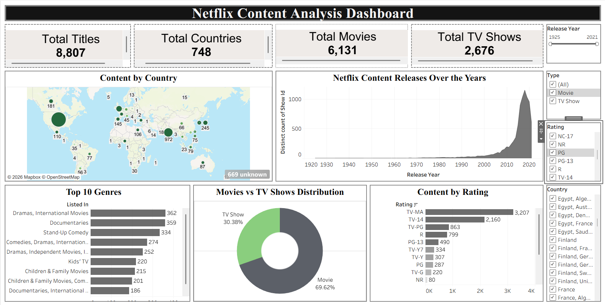

# 🎬 Netflix Content Analysis using Tableau

## 📌 Project Overview

This project explores Netflix Movies and TV Shows using Tableau Public. The objective is to analyse Netflix's content library and understand its distribution across content types, release years, genres, countries, and ratings.

An interactive dashboard was developed to present key insights through visualisations and filters.

## 🎯 Project Objectives

- Analyse the distribution of Movies and TV Shows.
- Explore Netflix content releases over the years.
- Identify the most common content categories.
- Examine content distribution across countries.
- Analyse content based on audience ratings.
- Build an interactive dashboard using Tableau Public.

## 🛠️ Tools & Technologies

- **Tableau Public** – Data visualisation and dashboard development.
- **Microsoft Excel / CSV** – Dataset storage and inspection.

## 📂 Dataset Information

**Dataset:** Netflix Movies and TV Shows

**Source:** Kaggle – Netflix Movies and TV Shows dataset.

The dataset contains **8,807 records and 12 columns**.

### Key Columns

| Column | Description |
|---|---|
| show_id | Unique identifier for each title |
| type | Movie or TV Show |
| title | Title of the content |
| director | Director of the content |
| cast | Cast members |
| country | Country associated with the content |
| date_added | Date added to Netflix |
| release_year | Original release year |
| rating | Content rating |
| duration | Movie duration or number of seasons |
| listed_in | Content genres and categories |
| description | Short description of the content |

## 📊 Dashboard Preview



## 📈 Dashboard Visualizations

The dashboard includes the following visualisations:

### 1. Key Performance Indicators (KPIs)
- Total Titles: 8,807
- Total Movies: 6,131
- Total TV Shows: 2,676
- Distinct Country Entries: 748

### 2. Movies vs TV Shows Distribution
A donut chart comparing the proportion of Movies and TV Shows in the Netflix dataset.

### 3. Netflix Content Releases Over the Years
An area chart illustrating the distribution of Netflix titles by their original release year.

### 4. Top 10 Genres
A horizontal bar chart highlighting the ten most frequently occurring content categories.

### 5. Content Distribution by Country
A geographical map showing the distribution of Netflix titles across countries.

### 6. Content by Rating
A horizontal bar chart comparing the number of titles across different content ratings.

## 🔍 Key Insights

- Movies account for approximately **69.62%** of the Netflix content library, while TV Shows account for **30.38%**.
- The dataset contains 6,131 Movies and 2,676 TV Shows.
- Netflix content releases increased significantly during the 2010s.
- Dramas, International Movies and Documentaries are among the leading content categories.
- TV-MA is the most common content rating in the dataset.
- The United States and India are among the prominent countries represented in the geographical distribution.

## 🎛️ Interactive Dashboard Features

The dashboard includes filters that allow users to explore the data dynamically:

- **Release Year:** Filter content by original release year.
- **Type:** Select Movies or TV Shows.
- **Rating:** Explore content based on ratings.
- **Country:** Filter titles using the country field.

These filters help users explore different aspects of Netflix's content library.

## ⚠️ Data Limitations

- Some records contain missing values in fields such as director, cast, country, and rating.
- The country column contains multiple countries in a single entry for some titles. Therefore, the distinct country-entry count does not represent the actual number of individual countries.
- Tableau does not recognise some combined country entries as individual geographic locations, resulting in unknown locations on the map.
- The genre chart represents the categories as recorded in the `listed_in` column, including combined genre entries.

## 📁 Project Structure

```text
Netflix-Content-Analysis-Tableau/
│
├── Netflix_Content_Analysis.twbx
├── netflix_titles.csv
├── dashboard.png
└── README.md
```

## 🚀 How to Explore the Project

1. Clone or download this repository.
2. Open `Netflix_Content_Analysis.twbx` using Tableau Desktop or Tableau Public.
3. Explore the dashboard visualisations.
4. Use the available filters to interact with the dashboard.

## 👨‍💻 Author

**Starlin Pereira**

